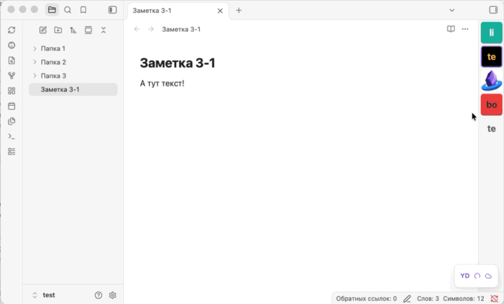
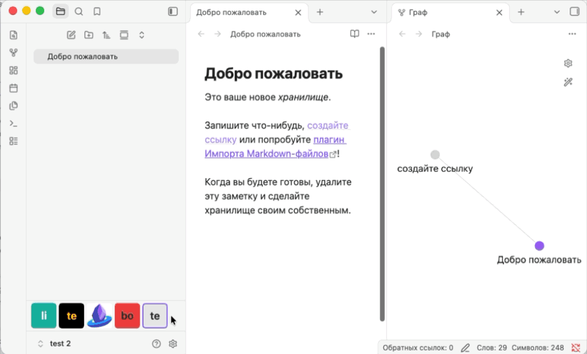
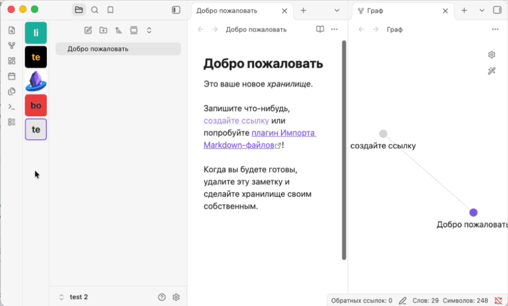
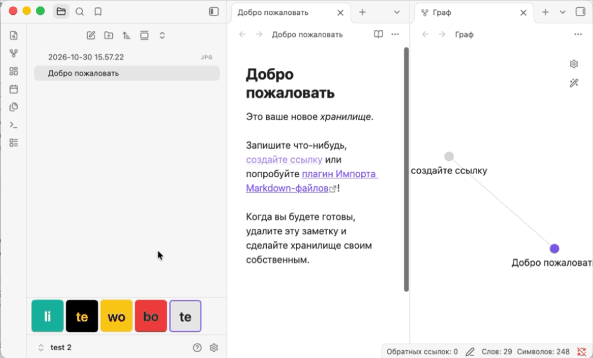

# Obsidian Vault Dock

[Русский](README_RU.md)

Obsidian Vault Dock adds a panel with tiles for your registered Obsidian vaults.
Click a tile to open its vault or bring its window into focus.

**Requirements** · Obsidian Desktop 1.15.0 or later.

**Interface languages** · English · Русский · Қазақша · Беларуская · O‘zbekcha ·
简体中文 · 繁體中文 · 日本語. The plugin follows Obsidian’s language by default
and uses English if that language is unavailable. You can choose a language in
the plugin settings.

## Features

- Place the bar below the left sidebar tabs (default), above Obsidian’s built-in
  vault switcher, or along the left or right edge of the workspace. The vertical
  bar stays visible when the sidebars are collapsed.
- Change **Tile size** in the plugin settings or drag the edge of the bar.
  Turn on **Hide vault labels** for square tiles.
- Right-click a tile to add, change, or remove its image. Tiles without images
  show the first two characters of the vault name. Use **Choose color** to set
  their background and text colors. Applying colors replaces the tile’s image
  with its initials.

## Demos

|                                              Switching vaults                                              |                                           Moving the dock                                            |
| :--------------------------------------------------------------------------------------------------------: | :--------------------------------------------------------------------------------------------------: |
|                                   |                    |
|                                             **Resizing tiles**                                             |                                       **Adding a tile image**                                        |
|  |  |

## Installation

1. With Node.js 22 and npm installed, run these commands from the repository
   directory.

   ```sh
   npm ci
   npm run build -- --no-install
   ```

2. In your vault, create `.obsidian/plugins/vault-dock/`.
3. Copy `main.js`, `manifest.json`, and `styles.css` from `build/` into that folder.
4. Restart Obsidian and enable **Obsidian Vault Dock** under
   **Settings → Community plugins**.

If you installed a build under the old `vault-switcher-bar` ID, disable it in
every vault first. Remove its old installation folder after installing and
enabling `vault-dock` in each vault. The plugin uses the existing settings
and tile images from the same Obsidian profile.

## First switch

Install and enable the plugin in two vaults, then click the other vault’s tile
to switch. Use **Switching mode** in the plugin settings to choose how the
windows behave.

The built-in Obsidian sidebar switcher uses the same mode as the Vault Dock
tiles. You can change it in either the switcher menu or the plugin settings.

| Mode                              | Current window                                  | Destination window                                    |
| --------------------------------- | ----------------------------------------------- | ----------------------------------------------------- |
| **Hide current window** (default) | Hides and keeps its tabs ready for your return. | Takes the current window’s size and position.         |
| **Close current window**          | Closes once the destination window is ready.    | Takes the current window’s size and position.         |
| **Keep both windows open**        | Stays visible.                                  | Opens or receives focus at its own size and position. |

In **Hide current window** mode, the current window closes if the plugin is
disabled or missing in the destination vault. When opening a closed vault,
Obsidian may briefly show its window at its previous position.

## Shared settings

The switching mode and tile images are shared across the Obsidian profile by
default. Turn off **Share settings across vaults** to configure them separately.
Turning it back on makes the current vault’s mode and images the shared settings.

The interface language, bar position, tile size, label visibility, and
tile colors always apply across the profile.

## Development

See the [development guide (in Russian)](docs/development.md) for build commands,
installation into test vaults, and manual checks.

## License

[MIT](LICENSE).
