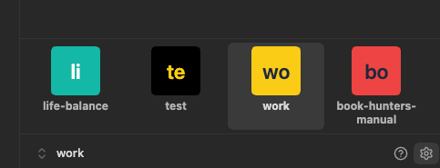
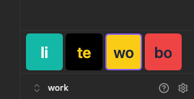
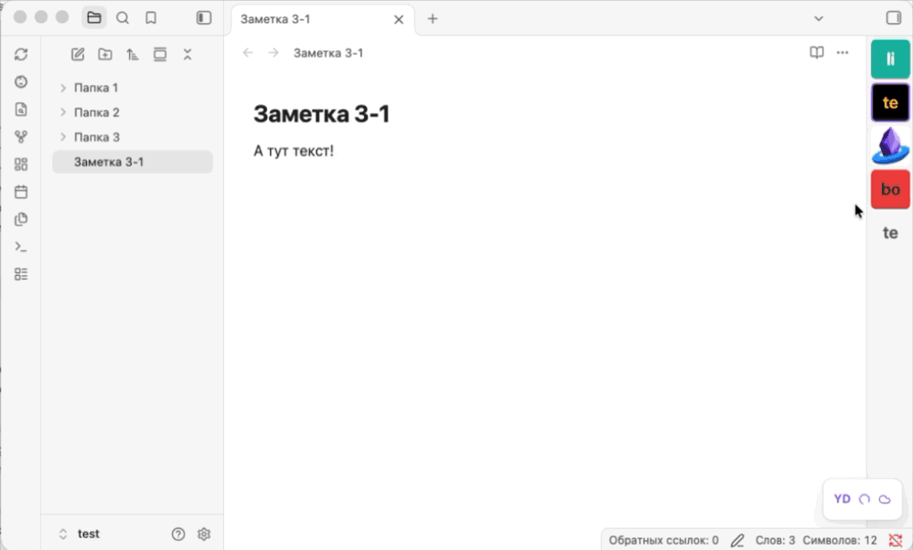
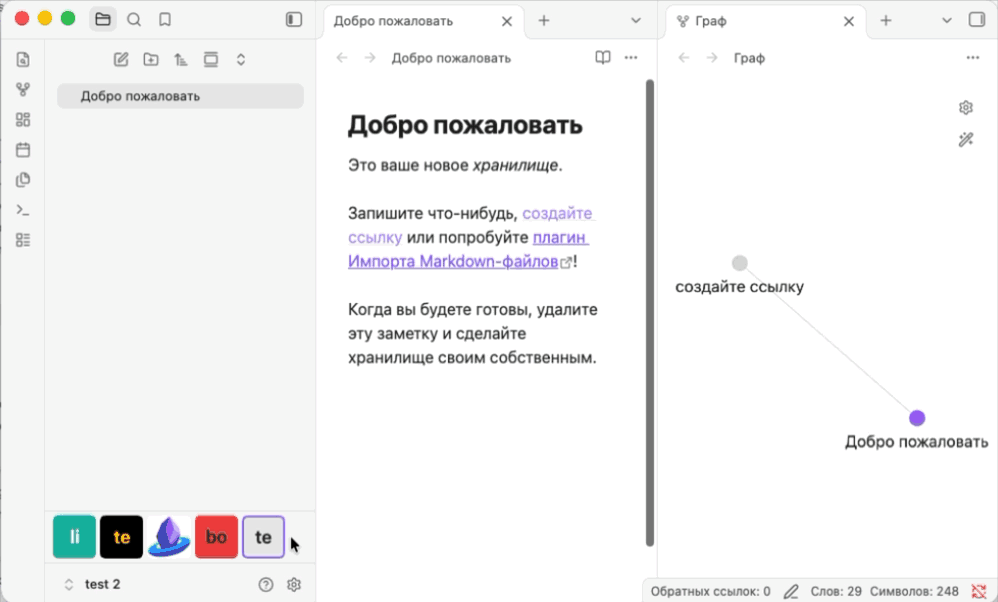
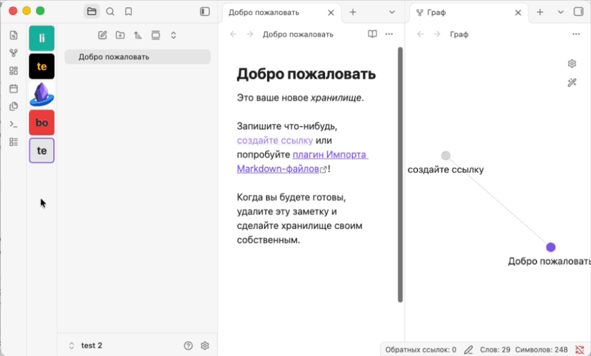
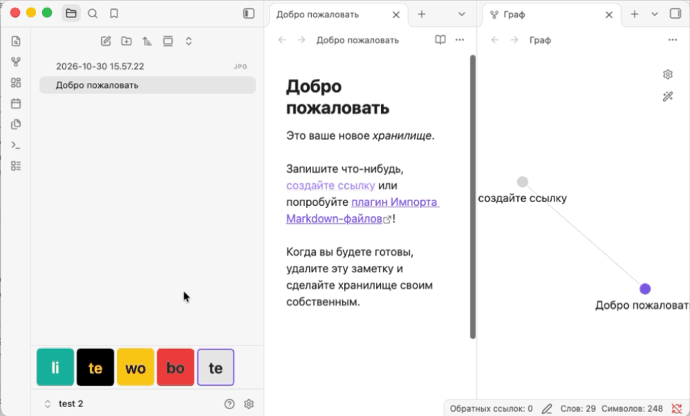

# Vault Dock

[English](README.md)

Vault Dock добавляет панель с плитками для открытия хранилищ Obsidian.
На компьютере плагин автоматически показывает все зарегистрированные
хранилища и позволяет перейти в уже открытое окно.

|                                  С подписями                                  |                                   Без подписей                                   |
| :---------------------------------------------------------------------------: | :------------------------------------------------------------------------------: |
|  |  |

**Требования** · Obsidian 1.15.0 или новее на компьютере, iOS и Android.

**Языки интерфейса** · English · Русский · Қазақша · Беларуская · O‘zbekcha ·
简体中文 · 繁體中文 · 日本語. По умолчанию плагин использует язык Obsidian
или английский, если этот язык недоступен. Язык можно выбрать в настройках
плагина.

## Возможности на компьютере

- Разместите панель под вкладками левой боковой панели (по умолчанию), над
  встроенным переключателем Obsidian, у левого или правого края рабочей области.
  Вертикальная панель остаётся видимой при свёрнутых боковых панелях.
- Измените **Размер плиток** в настройках плагина или перетащите край панели.
  Включите **Скрывать подписи хранилищ**, чтобы плитки стали квадратными.
- Нажмите на плитку правой кнопкой мыши, чтобы добавить, сменить или удалить
  картинку. На плитках без картинок отображаются первые два символа названия.
  Пункт **Выбрать цвет** меняет фон и цвет текста. При применении цветов
  картинка плитки заменяется инициалами.

## Демонстрации

|                                                Переключение хранилищ                                                 |                                        Перемещение панели                                        |
| :------------------------------------------------------------------------------------------------------------------: | :----------------------------------------------------------------------------------------------: |
|                                   |                   |
|                                             **Изменение размера плиток**                                             |                                **Добавление картинки на плитку**                                 |
|  |  |

## Установка

1. Скачайте `main.js`, `manifest.json` и `styles.css` из последнего
   [релиза на GitHub](https://github.com/Ivansushkin/obsidian-vault-dock/releases).
2. Создайте в хранилище папку `.obsidian/plugins/vault-dock/`.
3. Скопируйте в неё три скачанных файла.
4. Перезапустите Obsidian и включите **Vault Dock** в разделе
   **Настройки → Сторонние плагины**.

Если у вас установлена сборка с прежним ID `vault-switcher-bar`, сначала
отключите её во всех хранилищах. После установки и включения `vault-dock`
в каждом хранилище удалите папку прежней установки. Плагин использует
прежние настройки и картинки плиток из того же профиля Obsidian.

## Переключение на компьютере

Установите и включите плагин в двух хранилищах, затем нажмите на плитку второго
хранилища. Поведение окон задаётся в настройке **Режим переключения**.

| Режим                                    | Текущее окно                                | Целевое окно                                                 |
| ---------------------------------------- | ------------------------------------------- | ------------------------------------------------------------ |
| **Скрывать текущее окно** (по умолчанию) | Скрывается и сохраняет вкладки до возврата. | Принимает размер и позицию текущего окна.                    |
| **Закрывать текущее окно**               | Закрывается, когда целевое окно готово.     | Принимает размер и позицию текущего окна.                    |
| **Оставлять оба окна открытыми**         | Остаётся видимым.                           | Открывается или получает фокус со своим размером и позицией. |

В режиме **Скрывать текущее окно** исходное окно закрывается, если в целевом
хранилище плагин выключен или отсутствует. При открытии закрытого хранилища
Obsidian может на мгновение показать его окно в прежней позиции.

## Переключение на телефоне и планшете

Vault Dock автоматически показывает в левой панели хранилища из штатного
переключателя Obsidian. Нажмите на плитку для перехода. Включите Vault Dock
в каждом хранилище, где нужна панель.

Размер плиток, подписи и язык можно настроить отдельно в каждом хранилище.
Переходом и состоянием рабочей области управляет сам Obsidian.

## Общие настройки на компьютере

По умолчанию режим переключения и картинки плиток общие для профиля Obsidian.
Выключите **Общие настройки для всех хранилищ**, чтобы настроить их отдельно.
При повторном включении общими станут режим и картинки текущего хранилища.

Язык интерфейса, положение панели, размер плиток, видимость подписей и цвета
плиток всегда действуют во всём профиле.

## Локальные данные

Vault Dock использует реестр настольного Obsidian, чтобы узнать ID и пути
зарегистрированных хранилищ и открывать их окна. Когда вы выбираете картинку
для плитки, плагин читает выбранный файл, в том числе за пределами хранилищ.
Копия картинки и настройки панели хранятся в локальном профиле Obsidian.
На мобильном настройки внешнего вида хранятся в данных плагина для каждого
хранилища. Автоматически найденный список остаётся в памяти. Плагин работает
без сети.

## Разработка

Для сборки из исходников выполните `npm ci` с Node.js 22, затем запустите
`npm run build -- --no-install`. Три файла для установки появятся в `build/`.

Команды сборки, установка в тестовые хранилища и сценарии ручной проверки
описаны в [руководстве для разработчиков](docs/development.md).

## Лицензия

[MIT](LICENSE).
